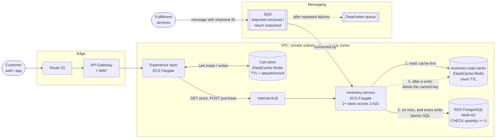

# Panel interview prep

- **Session ID:** `78adf0df-3007-46c0-bf31-068133e77538`
- **Started:** 2026-10-01T17:38:42.367Z
- **Last activity:** 2026-10-01T18:18:30.143Z
- **Model(s):** claude-opus-5-5
- **Raw log:** [raw/2026-10-01_02.jsonl](raw/2026-10-01_02.jsonl)

---

## User — 2026-10-01T17:38:42.367Z

_[IDE context: The user opened the file c:\Users\rober\Documents\Projects\Nuuly_Inventory_Assessment\postman\Nuuly_Inventory.postman_collection.json in the IDE. This may or may not be related to the current task.]_

The assessment went well. I got this email 

<pasted_content id="83ed">
Molly Weber
	
1:11 PM (25 minutes ago)
	
	
to me
Hi Robert,

Thanks for sending everything over yesterday!

Following up on our team discussion, we'd like to move forward with scheduling your panel interviews.

This stage will consist of a two-hour Zoom session broken down as follows:
* First Hour: Architect & Senior Software Engineer
* Second Hour: Architect & Software Engineer

Please let me know a few dates and times that work best for you over the next 1–2 weeks, and I'll get everything coordinated.
</pasted_content id="83ed">

So we will now be shifting into panel interview prep. Lets update the project memory and think of how we can get ready.

### Claude

Congratulations, that's a real milestone. Let me look at what's already in place for interview prep before proposing anything.

<details><summary>Tool call: Bash — Read memory, interview prep sheet, TODO and README outline</summary>

```json
{
  "command": "cd \"c:/Users/rober/Documents/Projects/Nuuly_Inventory_Assessment\"; M=\"C:/Users/rober/.claude/projects/c--Users-rober-Documents-Projects-Nuuly-Inventory-Assessment/memory\"; for f in next-feature-handoff interview-prep-sheet coaching-style; do echo \"=== $f\"; cat \"$M/$f.md\"; done; echo \"=== interview-prep.md\"; cat docs/learning/interview-prep.md; echo \"=== walkthroughs\"; ls docs/learning/walkthroughs docs/learning; echo \"=== TODO\"; cat .claude/TODO.md | head -80; echo \"=== README headings\"; grep -n \"^#\" README.md",
  "description": "Read memory, interview prep sheet, TODO and README outline"
}
```

</details>

<details><summary>Tool result</summary>

```
<persisted-output>
Output too large (53.1KB). Full output saved to: C:\Users\rober\.claude\projects\c--Users-rober-Documents-Projects-Nuuly-Inventory-Assessment\78adf0df-3007-46c0-bf31-068133e77538\tool-results\byi4gvqq4.txt

Preview (first 2KB):
=== next-feature-handoff
---
name: next-feature-handoff
description: "2026-09-30: testing feature SHIPPED (PR #8, merge 1edff46); walkthrough PARTIAL (stopped after NegativeControlTest); time-boxed: couple hours left to finish submission. Earlier: purchase feature SHIPPED 2026-09-29 (PR #6, merge e4f2aad); all four contract endpoints done; TODO cleanup shipped (PR #7, ec460f7); NEXT (2026-09-30): one big testing /feature (negative control, multi-instance, load, property-based, contract validation)"
metadata:
  node_type: memory
  type: project
  originSessionId: 4432d916-fcfe-4cf2-ba84-f8b332f0b72f
  modified: 2026-09-30T01:42:11.920Z
---

## 2026-09-30: submission polish shipped (PR #11, merge ad6505d) — resume here

docs/how-this-was-built.md + README "How this was built" summary (Robert approved; background line
"knowing Java-style backend work" confirmed), verified Try-it flow from a clean clone, charset (leave
text/plain, recorded) and seed data (none) decided. Remaining (TODO "Submission"): Robert sends the
recruiter note (draft given in chat), optionally finish the 2026-09-30 walkthrough.

## 2026-09-30: authorship audit shipped (PR #10, merge 8fcc716)

scripts/authorship_audit.py + commit-attribution rule (see [[commit-attribution]]). Robert wants the project
to show HOW he built it (AI as Kotlin teacher), not just that it works. Offered but NOT built yet: README top
"How this was built" paragraph and docs/how-this-was-built.md (rules, loop, audit, learning moments from
walkthrough logs, numbers: 94+ commits, 32 notes files, ~150 concept rows, 7 walkthroughs, 34+ prep Qs).

## 2026-09-30: CI shipped (PR #9, merge effcea3)

GitHub Actions `Tests` workflow (tests + load test jobs, pinned ubuntu-24.04), readable run summary
from scripts/test_report.py (for presenting test runs in the interview), /ship now waits for CI checks.
Offered (not done): a throwaway branch swapping in the naive purchase to demo a red CI run.

...
</persisted-output>
```

</details>

<details><summary>Tool call: Bash — Read prep sheet outline, docs layout, open TODOs</summary>

```json
{
  "command": "cd \"C:/Users/rober/Documents/Projects/Nuuly_Inventory_Assessment\"; M=\"C:/Users/rober/.claude/projects/c--Users-rober-Documents-Projects-Nuuly-Inventory-Assessment/memory\"; cat \"$M/interview-prep-sheet.md\"; echo \"=== prep headings\"; grep -n \"^#\" docs/learning/interview-prep.md; wc -l docs/learning/interview-prep.md; echo \"=== learning dir\"; ls docs/learning docs/learning/walkthroughs docs; echo \"=== TODO headings + unchecked\"; grep -n \"^#\\|\\[ \\]\" .claude/TODO.md; echo \"=== README headings\"; grep -n \"^#\" README.md",
  "description": "Read prep sheet outline, docs layout, open TODOs"
}
```

</details>

<details><summary>Tool result</summary>

```
---
name: interview-prep-sheet
description: Robert keeps an interview study sheet at docs/learning/interview-prep.md; add interview-worthy scenarios to it during walkthroughs
metadata:
  node_type: memory
  type: feedback
  originSessionId: 86cf4f68-4a0f-40ea-ad68-00e7e8418157
  modified: 2026-09-28T16:31:05.975Z
---

Robert asked (2026-09-28) for interview-worthy scenarios from walkthroughs (e.g. the duplicate-SKU /
`singleOrNull` vs `.single()` failure mode) to be saved to a study sheet at
`docs/learning/interview-prep.md`: question as heading, answer folded in `<details>`, link to notes.

**Why:** the follow-up interview is the goal; he wants one place to rehearse answers out loud.
**How to apply:** during [[coaching-style]] walkthroughs, when a check question or tangent exposes a
failure mode, design trade-off or "what if" a reviewer might ask, add it to the sheet (and to the
file's notes) without waiting to be asked; mention that you did.
=== prep headings
1:# Interview prep
9:## Design and failure modes
11:### What happens if two rows ever share the same SKU?
43:### Why does the repository return `null` for a missing SKU instead of throwing?
57:### How do you prevent SQL injection?
73:### Why a custom `SkuNotFoundException` instead of Spring's `ResponseStatusException`?
94:### What happens if the database is down during `GET /inventory`?
106:### Why one upsert instead of "look up the row, then insert or update"?
134:### Doesn't that row lock slow the service down?
152:### Why is the overflow guard written as `current <= MAX - new`?
171:### Your table has `CHECK (quantity >= 0)`. Isn't that enough to prevent overselling?
195:## API design and validation
197:### How does your API validate input?
221:### Stock can be 0. Why does the request require a quantity of at least 1?
242:### How would you add a new product that has no stock yet?
262:### `@Valid` already rejects 0. Why check again with `require` in the service?
283:### Creating a SKU returns 200, not 201, and a wrong Content-Type is 400, not 415. Why?
298:### A purchase has an invalid quantity *and* a SKU that doesn't exist. `400` or `404`?
320:## Kotlin
322:### What does the `?` in `InventoryItem?` mean, and how is it different from Java's `Optional`?
338:### Walk me through `class SkuNotFoundException(skuId: String) : RuntimeException("SKU not found: $skuId")`
369:### `private val`, `val`, or a plain parameter: what's the difference, and why are the layers `private val`?
391:### What is `?:`, and how does `getInventory` return a non-null `InventoryItem` from a nullable lookup?
415:### What if the service just passed the `null` up and the controller returned `InventoryItem?`?
436:### Why is the row mapper a lambda and not `query(InventoryItem::class.java)`?
449:### What does `data class` give you, and does it make the class immutable?
462:### Why does `removeStock` return a sealed `PurchaseResult` instead of `InventoryItem?` or throwing?
481:## Spring
483:### Two requests arrive at the same time. How many controller objects are there?
496:### What happens if you remove `@Service` from `InventoryService`?
508:### How does a `SkuNotFoundException` thrown in the service become a 404?
535:### Why don't your handlers send Spring's `ex.message` to the client?
550:### When does each kind of mistake surface: compile time, startup, or the first request?
572:### How would you deploy to a different database without changing any files?
585:## Database and migrations
587:### You need a new `created_at` column. What do you do?
599:## Testing
601:### How do you know `GET /inventory/{skuId}` works? What do the tests actually cover?
622:### If `findBySkuId` lost its `WHERE` clause, which repository tests would fail?
644:### How do you know your race tests would actually catch an oversell?
663:### Why does the purchase stay correct with several app instances?
674 docs/learning/interview-prep.md
=== learning dir
docs:
Nuuly_Assessment_Instructions.txt
ai-sessions
how-this-was-built.md

... [truncated 2242 chars; see raw log]
```

</details>

<details><summary>Claude reasoning</summary>

I've reviewed the existing material: 674 lines of prep Q&A, six walkthrough logs, and one unfinished walkthrough from testing on 2026-09-30. I'll update memory now, which is unaffected by working on `main` since it's stored outside the repo.

</details>

<details><summary>Tool call: Write</summary>

```json
{
  "file_path": "C:\\Users\\rober\\.claude\\projects\\c--Users-rober-Documents-Projects-Nuuly-Inventory-Assessment\\memory\\panel-interview-prep.md",
  "content": "---\nname: panel-interview-prep\ndescription: Take-home passed 2026-10-01; project is now in PANEL INTERVIEW PREP mode (2h Zoom, two architect-led hours)\nmetadata:\n  type: project\n---\n\nOn 2026-10-01 recruiter Molly Weber (Nuuly) emailed: the submission went well, and Nuuly wants to schedule\n**panel interviews**, a two-hour Zoom session within ~1–2 weeks of 2026-10-01:\n- Hour 1: Architect + Senior Software Engineer\n- Hour 2: Architect + Software Engineer\n\nRobert has to reply with available dates and times. The interview date is not set yet; record it here once known.\n\n**Why:** the project's goal has moved from \"build and submit\" to \"defend and extend it live\". He needs to explain\nevery line, discuss design trade-offs and extensions (an architect is in both hours), and probably code or\nreason without AI help in front of the panel.\n\n**How to apply:**\n- Prep work goes on a `docs/`/`chore/` branch as usual (see CLAUDE.md git workflow); Robert still writes all\n  `src/main/` code ([[robert-writes-production-code]]), so live-coding rehearsals mean he codes unaided while\n  Claude plays the interviewer.\n- Keep adding Q&A to `docs/learning/interview-prep.md` ([[interview-prep-sheet]]), now including\n  architect-level \"how would this change if...\" questions (Nuuly is a clothing *rental* business: items go out\n  and come back, sizes, warehouses).\n- Use the [[coaching-style]] (parallel examples, explain rules); in mock interviews, grade answers honestly.\n- Plan agreed on 2026-10-01 lives in `.claude/TODO.md` under \"Panel interview prep\".\n"
}
```

</details>

<details><summary>Tool call: Bash — Show handoff memory header and memory index</summary>

```json
{
  "command": "M=\"C:/Users/rober/.claude/projects/c--Users-rober-Documents-Projects-Nuuly-Inventory-Assessment/memory\"; sed -n 1,12p \"$M/next-feature-handoff.md\"; cat \"$M/MEMORY.md\"",
  "description": "Show handoff memory header and memory index"
}
```

</details>

<details><summary>Tool result</summary>

```
File created successfully at: C:\Users\rober\.claude\projects\c--Users-rober-Documents-Projects-Nuuly-Inventory-Assessment\memory\panel-interview-prep.md
```

</details>

<details><summary>Tool result</summary>

```
---
name: next-feature-handoff
description: "2026-09-30: testing feature SHIPPED (PR #8, merge 1edff46); walkthrough PARTIAL (stopped after NegativeControlTest); time-boxed: couple hours left to finish submission. Earlier: purchase feature SHIPPED 2026-09-29 (PR #6, merge e4f2aad); all four contract endpoints done; TODO cleanup shipped (PR #7, ec460f7); NEXT (2026-09-30): one big testing /feature (negative control, multi-instance, load, property-based, contract validation)"
metadata:
  node_type: memory
  type: project
  originSessionId: 4432d916-fcfe-4cf2-ba84-f8b332f0b72f
  modified: 2026-09-30T01:42:11.920Z
---

## 2026-09-30: submission polish shipped (PR #11, merge ad6505d) — resume here

- [GET /inventory checklist](get-inventory-checklist.md) — GET /inventory SHIPPED (PR #3, 934d5c0) 2026-09-25
- [Robert writes production code](robert-writes-production-code.md) — Claude writes tests + coaches; never edits src/main unasked
- [Coaching style](coaching-style.md) — Kotlin beginner: parallel examples, skip formatting nits, explain rules
- [Next feature handoff](next-feature-handoff.md) — 2026-09-30 testing feature SHIPPED (PR #8), CI + test report SHIPPED (PR #9), authorship audit SHIPPED (PR #10), submission polish SHIPPED (PR #11, ad6505d); walkthrough partial; purchase SHIPPED (PR #6, e4f2aad) 2026-09-29; TODO cleanup PR #7 shipped; NEXT 2026-09-30: one big testing /feature (negative control, multi-instance, load, property-based, contract validation)
- [Interview prep sheet](interview-prep-sheet.md) — add interview-worthy scenarios to docs/learning/interview-prep.md during walkthroughs
- [Commit attribution](commit-attribution.md) — Robert's-code commits get no Claude trailer; body note instead
```

</details>

<details><summary>Tool call: Bash — Update handoff memory and memory index</summary>

```json
{
  "command": "M=\"C:/Users/rober/.claude/projects/c--Users-rober-Documents-Projects-Nuuly-Inventory-Assessment/memory\"; python - \"$M\" <<'EOF'\nimport sys,re,pathlib\nm=pathlib.Path(sys.argv[1])\nh=m/\"next-feature-handoff.md\"; t=h.read_text(encoding=\"utf-8\")\nt=re.sub(r'^description: .*$', 'description: \"Build phase COMPLETE: submission sent 2026-09-30 and passed (2026-10-01); last shipped PR #12 Postman collection (e907572). Build history PR #3-#12. Now see panel-interview-prep.\"', t, count=1, flags=re.M)\nt=t.replace(\"## 2026-09-30: submission polish shipped\", \"## 2026-10-01: submission PASSED, phase over\\n\\nPostman collection shipped (PR #12, merge e907572). Recruiter replied 2026-10-01: moving to panel interviews.\\nThe build phase is done; ongoing work is tracked in [[panel-interview-prep]]. The 2026-09-30 testing walkthrough\\nis still partial (stopped after NegativeControlTest).\\n\\n## 2026-09-30: submission polish shipped\",1)\nh.write_text(t,encoding=\"utf-8\")\ni=m/\"MEMORY.md\"; s=i.read_text(encoding=\"utf-8\").splitlines()\ns=[(\"- [Build phase handoff](next-feature-handoff.md) — build phase DONE; submission passed 2026-10-01; PRs #3-#12 shipped (last: Postman, e907572); testing walkthrough still partial\" if l.startswith(\"- [Next feature handoff]\") else l) for l in s]\ns.insert(0,\"- [Panel interview prep](panel-interview-prep.md) — CURRENT PHASE (2026-10-01): 2h Nuuly panel (architect+senior SWE, architect+SWE), date TBD; plan in TODO\")\ni.write_text(\"\\n\".join(s)+\"\\n\",encoding=\"utf-8\")\nEOF\ncat \"$M/MEMORY.md\"",
  "description": "Update handoff memory and memory index"
}
```

</details>

<details><summary>Tool result</summary>

```
- [Panel interview prep](panel-interview-prep.md) — CURRENT PHASE (2026-10-01): 2h Nuuly panel (architect+senior SWE, architect+SWE), date TBD; plan in TODO
- [GET /inventory checklist](get-inventory-checklist.md) — GET /inventory SHIPPED (PR #3, 934d5c0) 2026-09-25
- [Robert writes production code](robert-writes-production-code.md) — Claude writes tests + coaches; never edits src/main unasked
- [Coaching style](coaching-style.md) — Kotlin beginner: parallel examples, skip formatting nits, explain rules
- [Build phase handoff](next-feature-handoff.md) — build phase DONE; submission passed 2026-10-01; PRs #3-#12 shipped (last: Postman, e907572); testing walkthrough still partial
- [Interview prep sheet](interview-prep-sheet.md) — add interview-worthy scenarios to docs/learning/interview-prep.md during walkthroughs
- [Commit attribution](commit-attribution.md) — Robert's-code commits get no Claude trailer; body note instead
```

</details>

### Claude

Personal memory is updated. Next, the in-repo project memory (CLAUDE.md and TODO). We're on `main`, and this session's work is clearly interview prep, so I'll branch first.

<details><summary>Tool call: Bash — Update main and create the interview prep branch</summary>

```json
{
  "command": "cd \"C:/Users/rober/Documents/Projects/Nuuly_Inventory_Assessment\" && git switch main && git pull --ff-only && git switch -c docs/panel-interview-prep && git status --short",
  "description": "Update main and create the interview prep branch"
}
```

</details>

<details><summary>Tool result</summary>

```
Already on 'main'
M	docs/ai-sessions/2026-10-01/2026-10-01_01.md
M	docs/ai-sessions/2026-10-01/raw/2026-10-01_01.jsonl
M	docs/ai-sessions/README.md
Your branch is up to date with 'origin/main'.
Already up to date.
Switched to a new branch 'docs/panel-interview-prep'
 M docs/ai-sessions/2026-10-01/2026-10-01_01.md
 M docs/ai-sessions/2026-10-01/raw/2026-10-01_01.jsonl
 M docs/ai-sessions/README.md
```

</details>

<details><summary>Tool call: Read</summary>

```json
{
  "file_path": "C:\\Users\\rober\\Documents\\Projects\\Nuuly_Inventory_Assessment\\.claude\\TODO.md",
  "offset": 83,
  "limit": 20
}
```

</details>

<details><summary>Tool result</summary>

```
83	## Working notes
84	
85	- 2026-09-30, branch `test/oversell-hardening`: one testing `/feature` covering every open test-plan item
86	  plus the contract-validation test. Decided (Robert): test-only naive repository, load test as JUnit +
87	  `HttpClient` in a separate `./gradlew loadTest`, Kotest property for property tests. All parts done
88	  (suite 124/124 + `loadTest`); README test claims match. Shipped PR #8; walkthrough partial (log lists the rest).
89	- 2026-09-30: CI with a readable test report (PR #9), authorship audit (PR #10), then `docs/submission-polish`:
90	  README "How this was built" + `docs/how-this-was-built.md`, verified "Try it" flow, charset and seed-data decisions.
91	
92	## Submission
93	
94	- [ ] Robert reviews `docs/how-this-was-built.md` (it's written in his voice; confirm his background line)
95	- [ ] Optional before the interview: finish the 2026-09-30 walkthrough (contract, property, HTTP client,
96	      multi-instance, load tests)
97	- [ ] Robert notifies the recruiter that the repository is ready
98	
99	## Oversell protection: test plan
100	
101	**Invariant: a purchase must never oversell, even when requests arrive at the same moment.**
102	Stock never goes below zero, and every unit sold was actually in stock. Test this at every
```

</details>

<details><summary>Tool call: Edit</summary>

```json
{
  "replace_all": false,
  "file_path": "C:\\Users\\rober\\Documents\\Projects\\Nuuly_Inventory_Assessment\\.claude\\TODO.md",
  "old_string": "## Submission\n\n- [ ] Robert reviews `docs/how-this-was-built.md` (it's written in his voice; confirm his background line)\n- [ ] Optional before the interview: finish the 2026-09-30 walkthrough (contract, property, HTTP client,\n      multi-instance, load tests)\n- [ ] Robert notifies the recruiter that the repository is ready\n",
  "new_string": "## Submission\n\n- [x] Robert reviews `docs/how-this-was-built.md` (approved 2026-09-30)\n- [x] Robert notifies the recruiter that the repository is ready (sent 2026-09-30)\n- [x] Take-home passed: recruiter invited Robert to panel interviews (2026-10-01)\n\n## Panel interview prep\n\nTwo-hour Zoom panel, date TBD (within ~2 weeks of 2026-10-01). Hour 1: Architect + Senior Software Engineer.\nHour 2: Architect + Software Engineer. Expect: a tour of the code, \"why\" questions, \"how would this change if...\"\ndesign questions, possibly live changes, and questions about how AI was used.\n\n- [ ] Robert replies to Molly with available dates and times\n- [ ] Finish the 2026-09-30 testing walkthrough (contract, property, HTTP client, multi-instance, load tests)\n- [ ] Code tour: Robert can present the project in 5 minutes and in 15 minutes, screen-shared, without notes\n- [ ] Demo readiness: clean clone → Docker up → app running → Postman calls → CI run, rehearsed on Zoom screen share\n- [ ] Architect questions: add a \"Design extensions\" section to `interview-prep.md` (rentals and returns, reservations,\n      idempotent purchases, multiple warehouses, events/outbox, pagination, caching, auth, observability, scale-out)\n- [ ] Live-coding rehearsal: Robert adds a small change unaided, timed, with Claude as the interviewer (no hints)\n- [ ] Mock interviews: one per panel hour, logged with feedback\n- [ ] Kotlin/Spring beyond the project: coroutines, scope functions, extension functions, collections, transactions\n- [ ] AI-use story: a short, honest answer to \"how did you use AI here?\", backed by `how-this-was-built.md` and the audit\n- [ ] Questions for the panel (team, inventory domain, stack, on-call, how they use Kotlin)\n"
}
```

</details>

<details><summary>Tool call: Edit</summary>

```json
{
  "replace_all": false,
  "file_path": "C:\\Users\\rober\\Documents\\Projects\\Nuuly_Inventory_Assessment\\CLAUDE.md",
  "old_string": "## Who writes what: Robert codes, Claude coaches",
  "new_string": "## Current phase: panel interview prep (since 2026-10-01)\n\nThe take-home passed. Next is a two-hour Zoom panel (hour 1: Architect + Senior Software Engineer; hour 2:\nArchitect + Software Engineer). The goal now is for Robert to **present, defend and extend** this code live,\nwithout AI help. The prep plan is in [.claude/TODO.md](.claude/TODO.md) under \"Panel interview prep\", and the\nQ&A sheet is [docs/learning/interview-prep.md](docs/learning/interview-prep.md). In mock interviews and\nlive-coding rehearsals, Claude plays the interviewer: ask, wait, then grade honestly. Give no hints until the\nanswer is in.\n\n## Who writes what: Robert codes, Claude coaches"
}
```

</details>

<details><summary>Tool result</summary>

```
The file C:\Users\rober\Documents\Projects\Nuuly_Inventory_Assessment\.claude\TODO.md has been updated successfully.
```

</details>

<details><summary>Tool result</summary>

```
The file C:\Users\rober\Documents\Projects\Nuuly_Inventory_Assessment\CLAUDE.md has been updated successfully.
```

</details>

### Claude

Memory is updated. Here's my read on how to prepare.

**What I changed**
- **Personal memory:** a new `panel-interview-prep` entry (panel format, date not set yet, how I should work in this phase). The old build handoff now says the build phase is done.
- **Repo:** I'm on a new branch, `docs/panel-interview-prep`. [CLAUDE.md](CLAUDE.md) has a new "Current phase" section. In mock sessions I play the interviewer and give no hints until you've answered. [.claude/TODO.md](.claude/TODO.md) has the Submission items checked off and a new "Panel interview prep" checklist.

**What the two hours will probably test**

Both hours have an architect, so expect fewer "what does `?:` do" questions and more "why did you build it this way, and what changes if…". In order of likely weight:

1. **Code tour.** Almost certainly first. You present the repo on screen share, and they interrupt with "why" questions. Your 674-line prep sheet already covers most of these.
2. **Design extensions.** This is the biggest gap right now. Nuuly *rents* clothes, so expect questions like:
   - Items go out and come back. How would you model that?
   - How would you hold an item in someone's cart?
   - A purchase request is retried after a timeout. How do you avoid charging stock twice?
   - What changes with multiple warehouses?
   - How would other services learn about stock changes? (events, the outbox pattern)
   - What about scale and caching, and what would you monitor?
3. **Live changes.** The senior and mid-level engineers may ask you to add something while they watch, with no AI. That's a different skill from writing code with a coach, so it needs its own practice.
4. **How you used AI.** Your audit and [docs/how-this-was-built.md](docs/how-this-was-built.md) are a strong story. You just need to tell it in about 60 seconds, confidently.
5. **Kotlin and Spring beyond this project.** Things like coroutines, scope functions and transactions could come up as "have you used X?" questions.

**Suggested order**
1. Finish the partial testing walkthrough. The oversell tests are the strongest thing in the repo, and you should own them fully.
2. Design-extension sessions. We talk each topic through, and I add the answers to the prep sheet.
3. Code-tour rehearsal at 5 and 15 minutes, plus a full demo dry run from a clean clone.
4. Timed live-coding rehearsals: you code unaided, I play the interviewer.
5. Two full mock interviews, one per panel hour, a day or two before the panel.

**Before the panel**
- **Reply to Molly.** Leave time for the plan above; a slot about 7–10 days out is reasonable. I can't see your calendar or email from here because the Gmail and Google Calendar connectors aren't authorized. You can authorize them in your claude.ai connector settings if you want help with that.
- **Commit.** These changes are ready for a docs commit with my co-author trailer, since it's my work. Proposed message: `Start panel interview prep: phase note in CLAUDE.md, prep checklist in TODO`. I'll commit when you say so.

Where do you want to start: finish the testing walkthrough, or start on the design extensions?

## User — 2026-10-01T17:43:03.620Z

commit

<details><summary>Tool call: Bash — Commit the CLAUDE.md and TODO changes</summary>

```json
{
  "command": "cd \"C:/Users/rober/Documents/Projects/Nuuly_Inventory_Assessment\" && git add CLAUDE.md .claude/TODO.md && git commit -q -F - <<'EOF'\nStart panel interview prep: phase note in CLAUDE.md, prep checklist in TODO\n\nCo-Authored-By: Claude Opus 5.5 <noreply@anthropic.com>\nEOF\ngit log --oneline -1 && git status --short",
  "description": "Commit the CLAUDE.md and TODO changes"
}
```

</details>

<details><summary>Tool result</summary>

```
d988706 Start panel interview prep: phase note in CLAUDE.md, prep checklist in TODO
 M docs/ai-sessions/2026-10-01/2026-10-01_01.md
 M docs/ai-sessions/2026-10-01/raw/2026-10-01_01.jsonl
 M docs/ai-sessions/README.md
 M docs/ai-sessions/sessions.json
?? docs/ai-sessions/2026-10-01/2026-10-01_02.md
?? docs/ai-sessions/2026-10-01/raw/2026-10-01_02.jsonl
```

</details>

### Claude

I committed the changes to `CLAUDE.md` and `.claude/TODO.md` as `d988706` on `docs/panel-interview-prep`, with my co-author trailer.

I didn't include the session transcript exports in `docs/ai-sessions/`. Earlier, those went in their own "Export AI session transcripts" commits, so I'll keep them separate. The branch isn't pushed; it can collect prep work and go out with `/ship` later.

Do you want to start by finishing the testing walkthrough or with the design-extension sessions?

## User — 2026-10-01T17:52:46.908Z

No I was thinking before we do that I wanted to talk about creating a hypothetical architectual diagram for if we were to host this service on AWS. What systems we would use. 

Thinking outloud i would probably host on fargate as the tps is probably somewhere around 100. Probably an upstream experience layer behind an api gateway and route 53 before we got to this inventory service layer. 
Inventory service layer connected to a posgres database where fullfulilment services update. Service also connects to a redis cache for cheap and quick access to the database data. Do wrtite through calls to update the cache and database. 

What do you think. We can discuss the design more that was just me thinking outloud

### Claude

Good instinct to talk it through first. The architects will judge this kind of design by your trade-offs, not by how many AWS boxes you draw. Here's what I'd keep, what I'd push back on, and what I think is missing.

**What holds up**

- **Fargate (ECS) is a good choice.** 100 TPS is small. It's worth being able to say why you didn't pick the alternatives:
  - **EKS** is a lot of cluster to run for one service.
  - **Lambda** would mean JVM cold starts, plus a database connection per invocation, which pushes you toward RDS Proxy.
  - **Fargate** keeps one Spring Boot process per container, so it runs the way it runs locally.
- **Run at least 2 tasks across 2 availability zones**, with autoscaling on CPU or request count. Your atomic SQL is what makes that safe: the multi-instance test already shows that two app instances can't oversell. Use that test as your evidence in the interview.
- **Route 53 → API Gateway → experience layer is a reasonable edge**, with WAF on the gateway. One adjustment: the inventory service shouldn't be public. The experience layer should reach it privately, through an internal ALB or ECS Service Connect inside the VPC, so the only way in is through the experience layer.
- **Postgres goes on RDS or Aurora PostgreSQL, Multi-AZ.** At 100 TPS, one primary has plenty of headroom.

**Where an architect will push back**

1. **Fulfillment services writing directly to the database.** This is the big one. If another service writes to your tables:
   - it skips your rules: the atomic update, the overflow guard, validation;
   - it ties their code to your schema, so you can't change a column without coordinating;
   - it never touches the cache, so the cache goes stale.

   The usual rule is that each service owns its data, and other services change it through that service. Fulfillment should either call your API (`POST /inventory` to receive stock) or publish an event ("shipment received") to SQS, EventBridge or Kafka, which the inventory service consumes. Events help when fulfillment shouldn't depend on inventory being up.

2. **Redis with write-through.** Two problems:
   - **The purchase must never be decided from the cache.** The decision has to be the atomic SQL against Postgres, or the oversell guarantee is gone. So the cache can only ever serve reads (`GET`).
   - **Write-through can leave the cache wrong.** The database write and the cache write are two separate steps, and nothing makes them happen together. Two purchases can update the database in order A then B, but update the cache in order B then A. The cache then holds A's stale count indefinitely. A failed cache write after a successful database write does the same thing.

   The safer pattern is cache-aside: reads fill the cache on a miss, every write *deletes* the key, and every key gets a short TTL as a safety net. Even better for the interview: **"at 100 TPS I wouldn't add Redis yet."** A primary-key lookup in Postgres takes about a millisecond. I'd add a cache when metrics show read load hurting the database. If read load ever does need relief, a read replica for `GET /inventory` is the simpler step first. A cache costs an extra system to run, plus stale data and failure modes. Saying "I'd measure first" is exactly what architects want to hear.

**What's missing**

- **Idempotency on purchases.** The gateway or the client retries after a timeout, and stock gets taken twice. An `Idempotency-Key` header, stored with the result, fixes it. Nuuly will care about this.
- **Database connection math.** Each task has a Hikari connection pool. Number of tasks × pool size has to stay under RDS `max_connections`, including during a deploy, when old and new tasks run side by side.
- **Operations:**
  - DB credentials in Secrets Manager;
  - Flyway migrations run at deploy (yours already run on startup; say whether that's still fine with several tasks starting at once);
  - CI/CD: GitHub Actions → ECR → ECS rolling deploy;
  - health checks on Spring Actuator;
  - CloudWatch plus OpenTelemetry/X-Ray, alarming on 5xx rate, p99 latency, and purchases refused for insufficient stock.

**Three questions to think about**

1. Fulfillment receives 500 units at a warehouse. Walk me through how that reaches your database, and what happens if the inventory service is down at that moment.
2. If you did add a cache, what's the worst a stale read can do here? Does it matter for a product page? For a purchase?
3. Nuuly *rents* clothes. Does "quantity" still describe a garment that's out with a customer and coming back next week?

Answer those in your own words, and once the design settles I'll draw the diagram. I'd suggest a Mermaid diagram in `docs/architecture.md`, since GitHub renders it in the repo and you can screen-share it. It could also be a standalone page if you'd rather have something more polished.

## User — 2026-10-01T17:58:35.304Z

1: I agree fullfillment should use the apis in the inventory service we just made. Not going outside of the service to the database. 
2: Worst a stale can do is the info on the site is not 100% up to date, but with such low tps the cost saving seems the bigger win for slightly stale data. 
3: No idea i assume not. I am not sure how they go about it but to keep it simple lets describe quantity as what they currently have in stock. Not what is with someone else.

### Claude

Here's how I'd grade those answers.

**1. Fulfillment uses the inventory API: right call, but half the question is unanswered.** I also asked what happens when the inventory service is down. That half matters, because it exposes a real weakness in our API: `POST /inventory` *adds* to stock. Suppose fulfillment sends "receive 500" and the request times out. Fulfillment can't tell whether the update landed, so it retries. If the first one did land, you now have 1,000 units on paper and 500 on the shelf. An architect who notices that will press on it.

You have two options:
- **Fulfillment calls the API directly, with an idempotency key.** Fulfillment sends a unique ID per shipment, and the inventory service records the IDs it has already applied, so a retry is a no-op. If inventory is down, fulfillment retries until it's back.
- **A queue in between (SQS).** Fulfillment drops a "shipment received" message on the queue and moves on, and the inventory service consumes it when it's able. If inventory is down, messages simply wait in the queue. You still need the shipment ID, because SQS can deliver a message more than once.

Either way, the shipment ID is the real fix. The queue adds buffering, so fulfillment doesn't depend on inventory being up.

**2. The stale-data reasoning is right, but the cost argument is backwards.** Redis doesn't *save* money here; it *adds* a cost. ElastiCache is another always-on node, plus the code and the ways it can fail. A cache pays off when it takes load off a database that's struggling, and at 100 TPS Postgres isn't struggling. The interview-ready version is:

> "Stale data would only affect what the site displays, because purchases always go to Postgres. But at 100 TPS the database handles reads easily, so a cache would add cost and complexity without a problem to solve. I'd add one when metrics show read pressure."

**3. That's a clean answer, and it's defensible.** Say it like this:

> "Quantity means units on hand and available to ship. Rented garments aren't counted. A return goes back through the receive endpoint once it's inspected and cleaned."

That ties returns neatly to the API you already have. Your "if I had more time" line could be: tracking individual garments with a status (available, rented, cleaning) instead of a count. You don't need to design it.

Two decisions before I draw the diagram:
1. **Fulfillment path:** direct API calls with an idempotency key, or an SQS queue in between?
2. **Redis:** leave it out, show it as a dashed "future, if metrics demand" box, or keep it as a real component?

Once you've decided, I'll draw the diagram in `docs/architecture.md`. I'll also add these three questions to the prep sheet, with answers in your own words.

## User — 2026-10-01T18:04:51.915Z

1: I like the sqs solution
2: But this saves in write and read costs to the database. Think if we have a user with items in their cart they are getting their data from a redis cache with ttl fror cart abandonment issues. At checkout we make a last call to the database to make sure the data is good then do a write through call to update the database and redis. Only call the database at the time of a transaction not anytime we need inventory info.

### Claude

SQS it is. On Redis, part of your argument is strong, but two parts would get picked apart in the interview, and one of them would undo the oversell protection.

**What's strong:** keeping carts in Redis with a TTL. Carts are short-lived, change often, and should expire on their own. A TTL is exactly the right tool for abandoned carts. That's a textbook use of Redis, and a good one to bring up.

**Problem 1: "check the database, then write" brings the race back.** Reading stock at checkout and then writing is two steps, and two shoppers can both read "1 left" between them. That's the oversell your whole design prevents. The good news is your purchase SQL already does the check and the write in one statement: `UPDATE ... WHERE quantity >= ?`. So the line for the interview is:

> "At checkout, the purchase is a single atomic UPDATE in Postgres. That *is* the final check."

There's no separate read before it.

**Problem 2: the cost argument doesn't fit RDS pricing.** RDS Postgres bills per instance-hour, not per query, so cheap reads cost nothing extra. Aurora Standard does bill per I/O, but at 100 TPS of primary-key lookups that's pennies, mostly served from memory. ElastiCache is a fixed, always-on cost on top. At this scale, caching inventory counts costs more than it saves. Your argument becomes right at a much larger scale, when product browsing sends thousands of reads a second and the database starts to strain. So the honest pitch is:

> "I'd cache when read volume justifies it, and here's how I'd do it."

**Problem 3: write-through can still go stale.** This is the ordering problem from before: two checkouts can update the database in one order and Redis in the other. The fix is to delete the cached key on every write instead of writing the new value. The next read refills the key from Postgres, and the TTL is the safety net.

**My suggested version of your design:**
- **Redis for carts,** owned by the experience/cart layer, with a TTL for abandonment.
- **Inventory counts cached in Redis** for product pages: cache-aside, delete on write, short TTL. This takes read load off Postgres when traffic grows.
- **Purchase:** always one atomic UPDATE in Postgres, never decided from the cache.
- **Fulfillment:** SQS → inventory service, deduplicated by shipment ID.

Do you agree with that version, or do you want to defend write-through? If you agree, I'll draw the diagram.

## User — 2026-10-01T18:07:08.878Z

yep sounds good. Lets look at the diagram

<details><summary>Tool call: Bash — Check prep sheet entry format and actuator/pool config</summary>

```json
{
  "command": "cd \"C:/Users/rober/Documents/Projects/Nuuly_Inventory_Assessment\" && sed -n 1,10p docs/learning/interview-prep.md && sed -n 134,152p docs/learning/interview-prep.md && sed -n 655,674p docs/learning/interview-prep.md; grep -rn \"spring-boot-starter-actuator\\|hikari\\|maximum-pool\" build.gradle.kts src/main/resources/application.yml",
  "description": "Check prep sheet entry format and actuator/pool config"
}
```

</details>

<details><summary>Tool result</summary>

```
# Interview prep

Questions a reviewer might ask in the follow-up interview, with short answers I should be able to
give out loud. Answers are folded: try each question first, then open it to check.

New questions are added during walkthroughs when a topic looks interview-worthy. Longer
explanations live in the [study notes](notes/README.md); each answer links to them.

## Design and failure modes

### Doesn't that row lock slow the service down?

<details>
<summary>Answer</summary>

No. It's the cheaper option:
- The lock is on **one row**, so different SKUs never wait for each other.
- It's held for one statement, well under a millisecond.
- Find-then-write needs two round trips, and making it *correct* (a transaction plus
  `SELECT ... FOR UPDATE`) holds a lock across both trips and the Kotlin in between, which is longer.

Where it would hurt: one extremely hot SKU taking thousands of writes a second queues on one row.
That's a scale problem with its own fixes (batching writes, splitting the counter across rows), far
beyond this app.

Notes: [InventoryRepository.kt](notes/main/inventory/InventoryRepository.kt.md#addstock-the-signature-and-the-two-decisions)
</details>

### Why is the overflow guard written as `current <= MAX - new`?
  10 and all write 9: twelve sales from ten units, the stock ends at 9, and no error is raised
  (9 passes `CHECK (quantity >= 0)`). The check fails on its `oversold` assertion, and the test
  asserts it failed for that reason.

Because the check is **shared**, this proves the exact assertions on the real code can detect a
lost update. See [NegativeControlTest notes](notes/test/inventory/NegativeControlTest.kt.md).
</details>

### Why does the purchase stay correct with several app instances?

<details>
<summary>Answer</summary>

The guarantee lives in Postgres, not in the app: one `UPDATE ... SET quantity = quantity - :q
WHERE quantity >= :q` takes a row lock, so a second buyer waits and re-checks against the new value.
A Kotlin-side fix (a `synchronized` block or a per-SKU lock around read-then-write) would pass the
single-app race tests but fail with two instances, because each JVM has its own lock.
`MultiInstanceRaceTest` starts two full app contexts on one database and races buyers across both
over HTTP to prove it. See [MultiInstanceRaceTest notes](notes/test/inventory/MultiInstanceRaceTest.kt.md).
</details>
```

</details>

<details><summary>Tool call: Bash — Read endpoint table and project layout from README</summary>

```json
{
  "command": "cd \"C:/Users/rober/Documents/Projects/Nuuly_Inventory_Assessment\" && sed -n 29,41p README.md && sed -n 226,264p README.md",
  "description": "Read endpoint table and project layout from README"
}
```

</details>

<details><summary>Tool result</summary>

````
## Endpoints

| Method | Path | Behavior | Responses | Status |
| --- | --- | --- | --- | --- |
| `GET` | `/inventory` | List every SKU and its quantity (`[]` when empty) | `200` JSON array | Implemented; tests green; reviewed and walked through |
| `GET` | `/inventory/{skuId}` | Current quantity for one SKU (`404` body: `SKU not found: <skuId>`) | `200` JSON, `404` text | Implemented; tests green; reviewed and walked through |
| `POST` | `/inventory/{skuId}` | Add stock; creates the SKU if it is new (one atomic upsert) | `200` JSON, `400` text | Implemented; tests green; reviewed and walked through |
| `POST` | `/inventory/{skuId}/purchase` | Deduct stock, only if enough is on hand (one atomic statement; `400` body: `Insufficient inventory for <skuId>`) | `200` JSON, `400` / `404` text | Implemented; tests green; reviewed and walked through |

Request bodies are `{"quantity": <integer ≥ 1>}`. Success bodies are
`{"skuId": "...", "quantity": <integer ≥ 0>}`. Error bodies are plain-text strings
(`text/plain`), not JSON.

## Project layout

```text
build.gradle.kts         The build: plugins, dependencies, Kotlin/Java settings
settings.gradle.kts      Project name (single-module build)
gradlew, gradle/wrapper/ Gradle wrapper; pins the Gradle version, nothing to install
compose.yaml             Local Postgres for bootRun
src/main/
  kotlin/com/robertwoolbright/inventory/
    InventoryApplication.kt   Entry point; component scan starts here
    inventory/                The inventory feature: controller, service, repository, models
      error/                  Domain exceptions and the handler that maps them to HTTP errors
  resources/
    application.yml           Spring Boot configuration
    db/migration/             Flyway SQL migrations (V1__..., V2__...)
    openapi/inventory.yaml    The OpenAPI contract (source of truth)
src/test/kotlin/com/robertwoolbright/inventory/
  inventory/                  Feature tests: repository, service, controller, contract, races,
                              negative control, multi-instance, property-based, load
  support/                    Shared test setup (Testcontainers Postgres, race helper, HTTP client)
.github/workflows/       CI: tests + load test on every push, with a readable report
.claude/                 Claude Code configuration (hooks, agents, skills) — see below
CLAUDE.md                Project memory and coding standards for Claude Code
docs/
  learning/
    notes/               Study notes: one per source file, explaining it chunk by chunk
    walkthroughs/        Logs of each /walkthrough session
    kotlin-concepts.md   Index of every Kotlin/Spring concept, linked to its notes
  ai-sessions/           Exported transcripts of every AI session on this project
scripts/                 Hook scripts (branch guard, KDoc check, session export) and the CI test report
```

**Package by feature.** Code is grouped by what it does (`inventory/`), not by technical
layer (`controller/`, `service/`, `repository/`). File names still show the layer, so the
controller → service → repository flow is easy to follow. This is a general JVM/Spring
convention, not a Kotlin rule. One Kotlin difference is worth knowing: Kotlin has no
package-private visibility. Its `internal` modifier means "visible within this Gradle
module", so package boundaries are organizational, not enforced by the compiler.
````

</details>

<details><summary>Tool call: Write</summary>

````json
{
  "file_path": "C:\\Users\\rober\\Documents\\Projects\\Nuuly_Inventory_Assessment\\docs\\architecture.md",
  "content": "# Hypothetical AWS architecture\n\nHow this inventory service could run in production on AWS. This is a design sketch for discussion; none of it\nis deployed. Sizing assumes about **100 requests per second** to the inventory service.\n\n```mermaid\nflowchart LR\n    customer([\"Customer<br/>web / app\"])\n    fulfillment([\"Fulfillment<br/>services\"])\n\n    subgraph edge[\"Edge\"]\n        r53[\"Route 53\"]\n        apigw[\"API Gateway<br/>+ WAF\"]\n    end\n\n    subgraph vpc[\"VPC: private subnets, 2 availability zones\"]\n        exp[\"Experience layer<br/>ECS Fargate\"]\n        cart[(\"Cart store<br/>ElastiCache Redis<br/>TTL = abandonment\")]\n        alb[\"Internal ALB\"]\n        inv[\"Inventory service<br/>ECS Fargate<br/>2+ tasks across 2 AZs\"]\n        invcache[(\"Inventory read cache<br/>ElastiCache Redis<br/>short TTL\")]\n        rds[(\"RDS PostgreSQL<br/>Multi-AZ<br/>CHECK quantity >= 0\")]\n    end\n\n    subgraph async[\"Messaging\"]\n        sqs[[\"SQS<br/>shipment received /<br/>return restocked\"]]\n        dlq[[\"Dead-letter queue\"]]\n    end\n\n    customer --> r53 --> apigw --> exp\n    exp <-->|\"cart reads / writes\"| cart\n    exp -->|\"GET stock, POST purchase\"| alb --> inv\n    inv -->|\"1. read: cache first\"| invcache\n    inv -->|\"2. on miss, and every write:<br/>atomic SQL\"| rds\n    inv -.->|\"3. after a write:<br/>delete the cached key\"| invcache\n    fulfillment -->|\"message with shipment ID\"| sqs\n    sqs -->|\"consumed by\"| inv\n    sqs -.->|\"after repeated failures\"| dlq\n```\n\nSupporting services, left off the diagram to keep it readable: **ECR** (container images), **GitHub Actions**\n(build, test, deploy to ECS), **Secrets Manager** (database credentials), **CloudWatch** and **OpenTelemetry /\nX-Ray** (logs, metrics, traces, alarms).\n\n## The main flows\n\n**Browsing a product page.** The experience layer asks the inventory service for a SKU. The inventory service\nchecks its Redis cache, and on a miss reads Postgres and fills the cache with a short TTL. A slightly stale count\nonly affects what the page displays.\n\n**Adding to cart.** The cart lives in the experience layer's Redis with a TTL, so abandoned carts expire on their\nown. Adding to a cart does not touch inventory; nothing is reserved.\n\n**Checkout.** The experience layer calls `POST /inventory/{skuId}/purchase`. The inventory service runs one atomic\n`UPDATE ... WHERE quantity >= :q` against Postgres. That statement is both the final check and the write, so\nthere is no separate read first, and the cache is never consulted. After a successful purchase the service\ndeletes the SKU's cache key; the next read refills it.\n\n**Receiving stock.** Fulfillment publishes a \"shipment received\" message with a unique shipment ID to SQS and\nmoves on. The inventory service consumes it and calls the same service code as `POST /inventory/{skuId}`, so the\nsame rules apply. If the inventory service is down, messages wait in the queue. Messages that keep failing go to\na dead-letter queue and raise an alarm.\n\n**Returns.** `quantity` means units on hand and available to ship. Garments out on rental are not counted. A\nreturn is restocked like a shipment: once it is inspected and cleaned, fulfillment sends a message and the count\ngoes up.\n\n## Decisions and trade-offs\n\n| Decision | Why | Rejected alternative |\n| --- | --- | --- |\n| ECS Fargate | One Spring Boot process per container, the same as locally; no servers or cluster to manage | **EKS**: a whole cluster for one service. **Lambda**: JVM cold starts, and a DB connection per invocation (needs RDS Proxy) |\n| 2+ tasks across 2 AZs | Survives losing a task or a zone. Safe because the oversell guarantee lives in Postgres, not in app memory (`MultiInstanceRaceTest`) | One task: a single point of failure |\n| Inventory service is private | Only
... [truncated 2724 chars; see raw log]
````

</details>

<details><summary>Tool result</summary>

```
File created successfully at: C:\Users\rober\Documents\Projects\Nuuly_Inventory_Assessment\docs\architecture.md (file state is current in your context — no need to Read it back)
```

</details>

### Claude

I'll add the three questions to the prep sheet too, as promised.

<details><summary>Tool call: Bash — Append architecture questions to the prep sheet</summary>

```json
{
  "command": "cd \"C:/Users/rober/Documents/Projects/Nuuly_Inventory_Assessment\" && cat >> docs/learning/interview-prep.md <<'EOF'\n\n## Architecture and production\n\nThe full sketch, with a diagram, is in [docs/architecture.md](../architecture.md).\n\n### How would you host this on AWS?\n\n<details>\n<summary>Answer</summary>\n\nRoute 53 and API Gateway (with WAF) in front of an experience layer, which calls the inventory service privately\nthrough an internal ALB. Both run on ECS Fargate, the inventory service as 2+ tasks across 2 availability zones,\nbacked by RDS PostgreSQL Multi-AZ. Fargate because at ~100 TPS a cluster (EKS) is overkill, and Lambda means JVM\ncold starts plus a database connection per invocation. Running several tasks is safe because the oversell\nguarantee lives in Postgres, not in app memory: `MultiInstanceRaceTest` proves it.\n</details>\n\n### Fulfillment receives 500 units. How does that reach your database, and what if inventory is down?\n\n<details>\n<summary>Answer</summary>\n\nNever by writing to the tables directly: the inventory service owns its data, so its rules always run.\nFulfillment publishes a \"shipment received\" message with a shipment ID to SQS. The inventory service consumes it\nand runs the same code as `POST /inventory/{skuId}`. If inventory is down, the messages wait in the queue.\n\nThe shipment ID matters because receiving *adds* stock, and SQS can deliver a message twice. Inserting the ID into\na `processed_shipments` table in the same transaction as the stock change makes a duplicate a no-op.\n</details>\n\n### Would you put a Redis cache in front of the inventory?\n\n<details>\n<summary>Answer</summary>\n\nCarts, yes: they're short-lived and a TTL handles abandonment. Inventory counts only when read traffic strains\nPostgres. At ~100 TPS a primary-key read is about a millisecond, and RDS bills per instance, not per query, so\na cache would add cost.\n\nIf I add one: cache-aside, delete the key on every write, short TTL. Not write-through, because the database write\nand the cache write aren't atomic: two purchases can update them in opposite orders and leave an old count cached.\nAnd a purchase never reads the cache: the atomic `UPDATE ... WHERE quantity >= :q` is the final check *and* the\nwrite. Checking first and then writing brings back the oversell race.\n</details>\n\n### Nuuly rents clothes. What does `quantity` mean for a garment that's out with a customer?\n\n<details>\n<summary>Answer</summary>\n\n`quantity` is units on hand and available to ship. Rented garments aren't counted. A return is restocked\nthrough the same receive path once it's inspected and cleaned. With more time, I'd track individual garments with\na status (available, rented, cleaning) instead of a count.\n</details>\nEOF\ntail -5 docs/learning/interview-prep.md",
  "description": "Append architecture questions to the prep sheet"
}
```

</details>

<details><summary>Tool result</summary>

```
`quantity` is units on hand and available to ship. Rented garments aren't counted. A return is restocked
through the same receive path once it's inspected and cleaned. With more time, I'd track individual garments with
a status (available, rented, cleaning) instead of a count.
</details>
```

</details>

<details><summary>Tool call: Edit</summary>

```json
{
  "replace_all": false,
  "file_path": "C:\\Users\\rober\\Documents\\Projects\\Nuuly_Inventory_Assessment\\.claude\\TODO.md",
  "old_string": "      idempotent purchases, multiple warehouses, events/outbox, pagination, caching, auth, observability, scale-out)",
  "new_string": "      idempotent purchases, multiple warehouses, events/outbox, pagination, caching, auth, observability, scale-out)\n  - [x] AWS hosting sketch: `docs/architecture.md` + \"Architecture and production\" prep questions (2026-10-01;\n        covers hosting, SQS receive with shipment dedup, caching, rentals/returns)"
}
```

</details>

<details><summary>Tool result</summary>

```
The file C:\Users\rober\Documents\Projects\Nuuly_Inventory_Assessment\.claude\TODO.md has been updated successfully.
```

</details>

### Claude

I've drawn the diagram in [docs/architecture.md](docs/architecture.md). I haven't checked that it renders, and VS Code's built-in Markdown preview won't draw it without the "Markdown Preview Mermaid Support" extension. GitHub draws Mermaid automatically once the branch is pushed.

**What's in the diagram**
- **The path in:** Route 53 → API Gateway + WAF → experience layer on Fargate. The experience layer reaches the inventory service through an internal ALB, so the inventory service stays private. The inventory service runs as at least 2 Fargate tasks across 2 availability zones.
- **Two separate Redis stores:**
  - the cart store, owned by the experience layer, with a TTL for abandoned carts;
  - the inventory read cache, owned by the inventory service, since that's the service that has to delete keys when stock changes.

  They can share one ElastiCache cluster, but each service owns its own keys.
- **The inventory service's three steps are numbered:** read the cache first; go to Postgres on a miss and for every write; delete the cached key after a write.
- **Fulfillment → SQS → inventory service,** with a dead-letter queue for messages that keep failing.

**What the rest of the doc covers**
- the main flows: browse, add to cart, checkout, receive stock, returns;
- a decisions table with the alternative rejected for each choice, in the same style as the README;
- what would have to change in the code: an SQS listener, a `processed_shipments` table to drop duplicate messages, the cache, an idempotency key on purchases, and how many tasks × connection-pool size Postgres can take.

**Also updated**
- [docs/learning/interview-prep.md](docs/learning/interview-prep.md) has a new "Architecture and production" section with four questions: hosting, the fulfillment path, caching, and what `quantity` means for rentals. The answers use your reasoning.
- The TODO marks this sub-item done.

None of this is committed yet.

Try explaining the diagram out loud as if you were screen-sharing it. Anything you'd word differently, tell me and I'll change the doc to match. You'll be the one presenting it, so it should sound like you.

## User — 2026-10-01T18:09:53.676Z

_[IDE selection]_
```
The user selected the lines 1 to 97 from c:\Users\rober\Documents\Projects\Nuuly_Inventory_Assessment\docs\architecture.md:
# Hypothetical AWS architecture

How this inventory service could run in production on AWS. This is a design sketch for discussion; none of it
is deployed. Sizing assumes about **100 requests per second** to the inventory service.



Supporting services, left off the diagram to keep it readable: **ECR** (container images), **GitHub Actions**
(build, test, deploy to ECS), **Secrets Manager** (database credentials), **CloudWatch** and **OpenTelemetry /
X-Ray** (logs, metrics, traces, alarms).

## The main flows

**Browsing a product page.** The experience layer asks the inventory service for a SKU. The inventory service
checks its Redis cache, and on a miss reads Postgres and fills the cache with a short TTL. A slightly stale count
only affects what the page displays.

**Adding to cart.** The cart lives in the experience layer's Redis with a TTL, so abandoned carts expire on their
own. Adding to a cart does not touch inventory; nothing is reserved.

**Checkout.** The experience layer calls `POST /inventory/{skuId}/purchase`. The inventory service runs one atomic
`UPDATE ... WHERE quantity >= :q` against Postgres. That statement is both the final check and the write, so
there is no separate read first, and the cache is never consulted. After a successful purchase the service
deletes the SKU's cache key; the next read refills it.

**Receiving stock.** Fulfillment publishes a "shipment received" message with a unique shipment ID to SQS and
moves on. The inventory service consumes it and calls the same service code as `POST /inventory/{skuId}`, so the
same rules apply. If the inventory service is down, messages wait in the queue. Messages that keep failing go to
a dead-letter queue and raise an alarm.

**Returns.** `quantity` means units on hand and available to ship. Garments out on rental are not counted. A
return is restocked like a shipment: once it is inspected and cleaned, fulfillment sends a message and the count
goes up.

## Decisions and trade-offs

| Decision | Why | Rejected alternative |
| --- | --- | --- |
| ECS Fargate | One Spring Boot process per container, the same as locally; no servers or cluster to manage | **EKS**: a whole cluster for one service. **Lambda**: JVM cold starts, and a DB connection per invocation (needs RDS Proxy) |
| 2+ tasks across 2 AZs | Survives losing a task or a zone. Safe because the oversell guarantee lives in Postgres, not in app memory (`MultiInstanceRaceTest`) | One task: a single point of failure |
| Inventory service is private | Only the experience layer can reach it, through an internal ALB | Exposing it through API Gateway: more attack surface, and clients would bypass the experience layer |
| Fulfillment goes through the inventory service | The service owns its data, so its rules (atomic update, overflow guard, cache invalidation) always run | Fulfillment writing to the tables directly: skips the rules, couples to the schema, leaves the cache stale |
| SQS between fulfillment and inventory | Fulfillment doesn't depend on inventory being up; messages wait and retry | Direct HTTP calls: fulfillment has to retry on its own when inventory is down |
| Deduplicate by shipment ID | SQS can deliver a message more than once, and receiving *adds* stock, so a duplicate would double-count | Trusting exactly-once delivery: SQS standard queues don't promise it |
| Cache-aside, delete on write, short TTL | Two writers can update Postgres and Redis in opposite orders; deleting the key can't leave a wrong value behind, and the TTL bounds any staleness | **Write-through**: the DB write and cache write aren't atomic, so the cache can end up holding an old count |
| Purchases never read the cache | The atomic SQL statement is the only thing that decides whether stock is available | Checking the cache (or doing a read, then a write) at checkout: brings back the oversell race |
| RDS PostgreSQL Multi-AZ | 100 TPS is a small load for one primary; Multi-AZ gives automatic failover | Aurora: worth it at larger scale; read replicas: not needed until reads strain the primary |

## What would have to change in the code

- **SQS consumer:** a listener (e.g. Spring Cloud AWS `@SqsListener`) that calls `InventoryService`.
- **Shipment deduplication:** a `processed_shipments` table. Insert the shipment ID and add the stock in one
  transaction, so a duplicate message fails on the primary key and changes nothing.
- **Cache:** a Redis read path in front of `getInventory`, and key deletion after each successful write.
- **Purchase idempotency:** an `Idempotency-Key` header, so a checkout retried after a timeout doesn't deduct twice.
- **Operations:** Spring Actuator health checks for the ALB, credentials from Secrets Manager, and connection-pool
  sizing (tasks × pool size must stay under RDS `max_connections`, including during a deploy).

## When the cache earns its place

At 100 TPS, Postgres serves primary-key reads in about a millisecond, and RDS bills per instance-hour, not per
query. An inventory cache is worth adding when browsing traffic grows to the point where reads strain the database.
The carts are a different case: they belong in Redis from day one, because they're short-lived and need to expire.


This may or may not be related to the current task.
```

Its just a document. Lets also have a diagram

### Claude

The Mermaid block shows as raw text in VS Code's preview, so I'll render it to an image and embed that in the doc.

<details><summary>Tool call: Bash — Check whether Node and npx are installed</summary>

```json
{
  "command": "node --version; npx --version",
  "description": "Check whether Node and npx are installed"
}
```

</details>

<details><summary>Tool result</summary>

```
v24.13.1
11.8.0
```

</details>

### Claude

You pasted the doc back, and I take that as confirmation it reads as text with no picture. I'm rendering the diagram to an image now.

<details><summary>Tool call: Bash — Render the Mermaid diagram to an SVG with mermaid-cli</summary>

````json
{
  "command": "cd \"C:/Users/rober/Documents/Projects/Nuuly_Inventory_Assessment\" && S=\"C:/Users/rober/AppData/Local/Temp/claude/c--Users-rober-Documents-Projects-Nuuly-Inventory-Assessment/78adf0df-3007-46c0-bf31-068133e77538/scratchpad\" && awk '/^```mermaid/{f=1;next}/^```/{f=0}f' docs/architecture.md > \"$S/arch.mmd\" && npx -y @mermaid-js/mermaid-cli@11 -i \"$S/arch.mmd\" -o docs/architecture.svg -b white 2>&1 | tail -5; ls -la docs/architecture.svg",
  "description": "Render the Mermaid diagram to an SVG with mermaid-cli",
  "timeout": 400000
}
````

</details>

<details><summary>Tool result</summary>

```
Generating single mermaid chart
-rw-r--r-- 1 rober 197609 118136 Oct  1 14:10 docs/architecture.svg
```

</details>

<details><summary>Tool call: Bash — Render a PNG copy to inspect the layout</summary>

```json
{
  "command": "S=\"C:/Users/rober/AppData/Local/Temp/claude/c--Users-rober-Documents-Projects-Nuuly-Inventory-Assessment/78adf0df-3007-46c0-bf31-068133e77538/scratchpad\" && npx -y @mermaid-js/mermaid-cli@11 -i \"$S/arch.mmd\" -o \"$S/arch.png\" -b white -s 2 2>&1 | tail -2",
  "description": "Render a PNG copy to inspect the layout",
  "timeout": 300000
}
```

</details>

<details><summary>Tool call: Read</summary>

```json
{
  "file_path": "C:\\Users\\rober\\AppData\\Local\\Temp\\claude\\c--Users-rober-Documents-Projects-Nuuly-Inventory-Assessment\\78adf0df-3007-46c0-bf31-068133e77538\\scratchpad\\arch.png"
}
```

</details>

<details><summary>Tool result</summary>

```
Generating single mermaid chart
```

</details>

<details><summary>Tool result</summary>

```
[image content]
```

</details>

### Claude

The layout is readable, but the "consumed by" label sits on top of the VPC title. I'll drop that label (the arrow already shows the direction) and re-render.

<details><summary>Tool call: Bash — Remove the overlapping label and re-render SVG and PNG</summary>

````json
{
  "command": "cd \"C:/Users/rober/Documents/Projects/Nuuly_Inventory_Assessment\" && S=\"C:/Users/rober/AppData/Local/Temp/claude/c--Users-rober-Documents-Projects-Nuuly-Inventory-Assessment/78adf0df-3007-46c0-bf31-068133e77538/scratchpad\" && sed -i 's/    sqs -->|\"consumed by\"| inv/    sqs --> inv/' docs/architecture.md && awk '/^```mermaid/{f=1;next}/^```/{f=0}f' docs/architecture.md > \"$S/arch.mmd\" && npx -y @mermaid-js/mermaid-cli@11 -i \"$S/arch.mmd\" -o docs/architecture.svg -b white >/dev/null 2>&1 && npx -y @mermaid-js/mermaid-cli@11 -i \"$S/arch.mmd\" -o \"$S/arch.png\" -b white -s 2 >/dev/null 2>&1; ls -la docs/architecture.svg",
  "description": "Remove the overlapping label and re-render SVG and PNG",
  "timeout": 400000
}
````

</details>

<details><summary>Tool call: Read</summary>

```json
{
  "file_path": "C:\\Users\\rober\\AppData\\Local\\Temp\\claude\\c--Users-rober-Documents-Projects-Nuuly-Inventory-Assessment\\78adf0df-3007-46c0-bf31-068133e77538\\scratchpad\\arch.png"
}
```

</details>

<details><summary>Tool result</summary>

```
-rw-r--r-- 1 rober 197609 118096 Oct  1 14:11 docs/architecture.svg
```

</details>

<details><summary>Tool result</summary>

```
[image content]
```

</details>

### Claude

Clean now. Next I'll embed the image at the top of the doc and fold the Mermaid source away for editing.

<details><summary>Tool call: Bash — Embed the SVG and fold the Mermaid source</summary>

````json
{
  "command": "cd \"C:/Users/rober/Documents/Projects/Nuuly_Inventory_Assessment\" && python - <<'EOF'\nimport pathlib\np=pathlib.Path(\"docs/architecture.md\"); t=p.read_text(encoding=\"utf-8\")\nt=t.replace(\"```mermaid\\n\", \"\\n\\n<details>\\n<summary>Diagram source (Mermaid)</summary>\\n\\nEdit this, then regenerate the image:\\n`npx -y @mermaid-js/mermaid-cli@11 -i <file>.mmd -o docs/architecture.svg -b white`\\n\\n```mermaid\\n\",1)\ni=t.index(\"```mermaid\"); j=t.index(\"```\\n\", i+10)+4\nt=t[:j]+\"\\n</details>\\n\"+t[j:]\np.write_text(t,encoding=\"utf-8\")\nEOF\nsed -n 1,20p docs/architecture.md; sed -n 44,52p docs/architecture.md",
  "description": "Embed the SVG and fold the Mermaid source"
}
````

</details>

<details><summary>Tool result</summary>

````
# Hypothetical AWS architecture

How this inventory service could run in production on AWS. This is a design sketch for discussion; none of it
is deployed. Sizing assumes about **100 requests per second** to the inventory service.


<details>
<summary>Diagram source (Mermaid)</summary>

Edit this, then regenerate the image:
`npx -y @mermaid-js/mermaid-cli@11 -i <file>.mmd -o docs/architecture.svg -b white`

```mermaid
flowchart LR
    customer(["Customer<br/>web / app"])
    fulfillment(["Fulfillment<br/>services"])

    subgraph edge["Edge"]
        r53["Route 53"]
    fulfillment -->|"message with shipment ID"| sqs
    sqs --> inv
    sqs -.->|"after repeated failures"| dlq
```

</details>

Supporting services, left off the diagram to keep it readable: **ECR** (container images), **GitHub Actions**
(build, test, deploy to ECS), **Secrets Manager** (database credentials), **CloudWatch** and **OpenTelemetry /
````

</details>

### Claude

The diagram is now a picture: I rendered it to [docs/architecture.svg](docs/architecture.svg) and embedded it at the top of [docs/architecture.md](docs/architecture.md). It shows up in VS Code's Markdown preview and on GitHub, and you can also open the SVG file directly.

- **Layout:**
  - **Left to right:** Customer → Edge (Route 53 → API Gateway + WAF) → VPC.
  - **Inside the VPC:** the experience layer with its cart store, then the internal ALB → inventory service. The inventory service's numbered arrows go to the read cache and Postgres.
  - **Messaging, across the top:** Fulfillment → SQS → inventory service, with the dead-letter queue.
- **One change:** I removed the "consumed by" label on the SQS → inventory arrow because it overlapped the VPC title. The arrow already shows the direction.
- **Editing it later:** the Mermaid source is folded under the image, with the one-line command to regenerate the SVG.

The diagram, doc and prep-sheet changes aren't committed yet. When you're happy with them, I'd commit them together as `Add hypothetical AWS architecture with diagram and prep questions`.

## User — 2026-10-01T18:12:39.470Z

_[IDE context: The user opened the file c:\Users\rober\Documents\Projects\Nuuly_Inventory_Assessment\docs\architecture.md in the IDE. This may or may not be related to the current task.]_

Lets create an architecture directory and have these two files in there

<details><summary>Tool call: Bash — Move architecture files into docs/architecture and fix links</summary>

```json
{
  "command": "cd \"C:/Users/rober/Documents/Projects/Nuuly_Inventory_Assessment\" && mkdir -p docs/architecture && mv docs/architecture.md docs/architecture.svg docs/architecture/ && sed -i 's/-o docs\\/architecture.svg/-o docs\\/architecture\\/architecture.svg/' docs/architecture/architecture.md && sed -i 's#\\[docs/architecture.md\\](../architecture.md)#[docs/architecture/architecture.md](../architecture/architecture.md)#' docs/learning/interview-prep.md && sed -i 's#`docs/architecture.md`#`docs/architecture/architecture.md`#' .claude/TODO.md && grep -rn \"architecture\\.md\\|architecture\\.svg\" --include=*.md . | grep -v ai-sessions; ls docs/architecture",
  "description": "Move architecture files into docs/architecture and fix links"
}
```

</details>

<details><summary>Tool result</summary>

```
./.claude/TODO.md:110:  - [x] AWS hosting sketch: `docs/architecture/architecture.md` + "Architecture and production" prep questions (2026-10-01;
./docs/architecture/architecture.md:6:
./docs/architecture/architecture.md:12:`npx -y @mermaid-js/mermaid-cli@11 -i <file>.mmd -o docs/architecture/architecture.svg -b white`
./docs/learning/interview-prep.md:678:The full sketch, with a diagram, is in [docs/architecture/architecture.md](../architecture/architecture.md).
architecture.md
architecture.svg
```

</details>

### Claude

Both files now live in [docs/architecture/](docs/architecture/): [architecture.md](docs/architecture/architecture.md) and [architecture.svg](docs/architecture/architecture.svg).

- **Image:** the doc embeds the image by a path relative to the doc itself, so it still works.
- **Links:** I updated the link at the top of the prep sheet's "Architecture and production" section, the TODO entry, and the regenerate command inside the doc. A search finds no other references to the old paths.

Still uncommitted, ready whenever you are.

## User — 2026-10-01T18:14:32.557Z

looks good. Lets add to our panel interview prep practicing going over the diagram

<details><summary>Tool call: Bash — Show the current panel prep section of the TODO</summary>

```json
{
  "command": "cd \"C:/Users/rober/Documents/Projects/Nuuly_Inventory_Assessment\" && sed -n 100,125p .claude/TODO.md",
  "description": "Show the current panel prep section of the TODO"
}
```

</details>

<details><summary>Tool result</summary>

```
Two-hour Zoom panel, date TBD (within ~2 weeks of 2026-10-01). Hour 1: Architect + Senior Software Engineer.
Hour 2: Architect + Software Engineer. Expect: a tour of the code, "why" questions, "how would this change if..."
design questions, possibly live changes, and questions about how AI was used.

- [ ] Robert replies to Molly with available dates and times
- [ ] Finish the 2026-09-30 testing walkthrough (contract, property, HTTP client, multi-instance, load tests)
- [ ] Code tour: Robert can present the project in 5 minutes and in 15 minutes, screen-shared, without notes
- [ ] Demo readiness: clean clone → Docker up → app running → Postman calls → CI run, rehearsed on Zoom screen share
- [ ] Architect questions: add a "Design extensions" section to `interview-prep.md` (rentals and returns, reservations,
      idempotent purchases, multiple warehouses, events/outbox, pagination, caching, auth, observability, scale-out)
  - [x] AWS hosting sketch: `docs/architecture/architecture.md` + "Architecture and production" prep questions (2026-10-01;
        covers hosting, SQS receive with shipment dedup, caching, rentals/returns)
- [ ] Live-coding rehearsal: Robert adds a small change unaided, timed, with Claude as the interviewer (no hints)
- [ ] Mock interviews: one per panel hour, logged with feedback
- [ ] Kotlin/Spring beyond the project: coroutines, scope functions, extension functions, collections, transactions
- [ ] AI-use story: a short, honest answer to "how did you use AI here?", backed by `how-this-was-built.md` and the audit
- [ ] Questions for the panel (team, inventory domain, stack, on-call, how they use Kotlin)

## Oversell protection: test plan

**Invariant: a purchase must never oversell, even when requests arrive at the same moment.**
Stock never goes below zero, and every unit sold was actually in stock. Test this at every
level we build, using several different mechanisms, because each one catches a different
class of bug. Each item below is also a teaching topic for a walkthrough.

### Correctness in isolation
```

</details>

<details><summary>Tool call: Edit</summary>

```json
{
  "replace_all": false,
  "file_path": "C:\\Users\\rober\\Documents\\Projects\\Nuuly_Inventory_Assessment\\.claude\\TODO.md",
  "old_string": "        covers hosting, SQS receive with shipment dedup, caching, rentals/returns)\n",
  "new_string": "        covers hosting, SQS receive with shipment dedup, caching, rentals/returns)\n- [ ] Architecture diagram rehearsal: Robert presents `docs/architecture/architecture.svg` on screen share\n  - [ ] 2-minute version: left to right, what each box is and why it's there\n  - [ ] Trace each flow out loud on the diagram: browse, add to cart, checkout, receive stock, return\n  - [ ] Q&A drill: Claude plays the architect and probes it (what fails if X goes down, why not write-through,\n        why SQS, why Fargate over Lambda/EKS, connection math, idempotency); grade answers, add gaps to the prep sheet\n  - [ ] Redraw it from memory (whiteboard or paper) in case the panel asks for a live sketch\n"
}
```

</details>

<details><summary>Tool result</summary>

```
The file C:\Users\rober\Documents\Projects\Nuuly_Inventory_Assessment\.claude\TODO.md has been updated successfully.
```

</details>

### Claude

I added an "Architecture diagram rehearsal" item to the "Panel interview prep" section of [.claude/TODO.md](.claude/TODO.md), right under the AWS hosting sketch. It has four steps:

1. **2-minute version:** walk the diagram left to right, saying what each box is and why it's there.
2. **Trace each flow on the diagram:** browse, add to cart, checkout, receive stock, return.
3. **Q&A drill:** I play the architect and probe the design: what fails if a component goes down, why not write-through, why SQS, why Fargate over Lambda or EKS, connection math, idempotency. I grade your answers honestly and add any gaps to the prep sheet.
4. **Redraw it from memory** on paper or a whiteboard, in case the panel asks you to sketch it live.

The Markdown linter warnings that came up are from the older test-plan section further down, not from this edit.

Uncommitted so far: the architecture folder, the prep-sheet section and the TODO changes. I'd commit them together as `Add hypothetical AWS architecture with diagram and prep questions`. Say "commit", or start the 2-minute version whenever you're ready.

## User — 2026-10-01T18:17:19.722Z

commit

<details><summary>Tool call: Bash — Commit the architecture docs, prep sheet and TODO</summary>

```json
{
  "command": "cd \"C:/Users/rober/Documents/Projects/Nuuly_Inventory_Assessment\" && git add docs/architecture docs/learning/interview-prep.md .claude/TODO.md && git commit -q -F - <<'EOF'\nAdd hypothetical AWS architecture with diagram and prep questions\n\nCo-Authored-By: Claude Opus 5.5 <noreply@anthropic.com>\nEOF\ngit log --oneline -2 && git status --short",
  "description": "Commit the architecture docs, prep sheet and TODO"
}
```

</details>

<details><summary>Tool result</summary>

```
warning: in the working copy of '.claude/TODO.md', LF will be replaced by CRLF the next time Git touches it
warning: in the working copy of 'docs/learning/interview-prep.md', LF will be replaced by CRLF the next time Git touches it
warning: in the working copy of 'docs/architecture/architecture.md', LF will be replaced by CRLF the next time Git touches it
d620d4f Add hypothetical AWS architecture with diagram and prep questions
d988706 Start panel interview prep: phase note in CLAUDE.md, prep checklist in TODO
 M docs/ai-sessions/2026-10-01/2026-10-01_01.md
 M docs/ai-sessions/2026-10-01/raw/2026-10-01_01.jsonl
 M docs/ai-sessions/README.md
 M docs/ai-sessions/sessions.json
?? docs/ai-sessions/2026-10-01/2026-10-01_02.md
?? docs/ai-sessions/2026-10-01/raw/2026-10-01_02.jsonl
```

</details>

### Claude

I committed the architecture work as `d620d4f` on `docs/panel-interview-prep`. It includes:
- `docs/architecture/` (the doc and the SVG);
- the prep sheet's "Architecture and production" section;
- the TODO updates, including the new rehearsal item.

The session transcript exports are still left for their own commit. The branch now has two commits and isn't pushed yet.

Ready for the 2-minute walkthrough of the diagram whenever you are.

## User — 2026-10-01T18:18:24.373Z

Lets ship all the changes

<details><summary>Tool call: Skill</summary>

```json
{
  "skill": "ship"
}
```

</details>

<details><summary>Tool error</summary>

```
<tool_use_error>Skill ship cannot be used with Skill tool due to disable-model-invocation. Ask the user to run /ship themselves — it cannot be invoked via the Skill tool. Do not replicate this skill's workflow by other means — it is reserved for explicit user invocation.</tool_use_error>
```

</details>

### Claude

I can't start `/ship` myself: it's set up so that only you can trigger it. Please type `/ship` in the chat to run it.

The branch `docs/panel-interview-prep` has two commits ready (`d988706` and `d620d4f`). The session transcript exports in `docs/ai-sessions/` are still uncommitted, and `/ship` handles them as part of its run.
