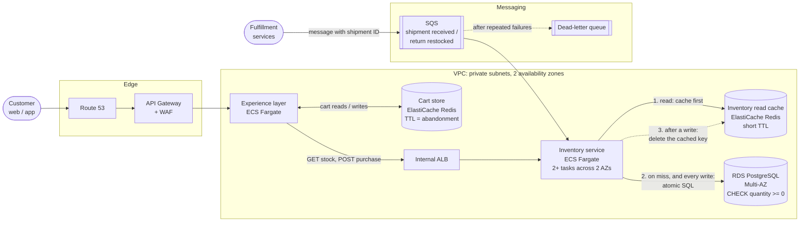

# Hypothetical AWS architecture

How this inventory service could run in production on AWS. This is a design sketch for discussion; none of it
is deployed. Sizing assumes about **100 requests per second** to the inventory service.

Diagram source (Mermaid)

Edit this, then regenerate the image:
`npx -y @mermaid-js/mermaid-cli@11 -i <file>.mmd -o docs/architecture/architecture.svg -b white`

Supporting services, left off the diagram to keep it readable: **ECR** (container images), **GitHub Actions**
(build, test, deploy to ECS), **Secrets Manager** (database credentials), **CloudWatch** and **OpenTelemetry /
X-Ray** (logs, metrics, traces, alarms).

## The main flows

**Browsing a product page.** The experience layer asks the inventory service for a SKU. The inventory service
checks its Redis cache, and on a miss reads Postgres and fills the cache with a short TTL. A slightly stale count
only affects what the page displays.

**Adding to cart.** The cart lives in the experience layer's Redis with a TTL, so abandoned carts expire on their
own. Adding to a cart does not touch inventory; nothing is reserved.

**Checkout.** The experience layer calls `POST /inventory/{skuId}/purchase`. The inventory service runs one atomic
`UPDATE ... WHERE quantity >= :q` against Postgres. That statement is both the final check and the write, so
there is no separate read first, and the cache is never consulted. After a successful purchase the service
deletes the SKU's cache key; the next read refills it.

**Receiving stock.** Fulfillment publishes a "shipment received" message with a unique shipment ID to SQS and
moves on. The inventory service consumes it and calls the same service code as `POST /inventory/{skuId}`, so the
same rules apply. If the inventory service is down, messages wait in the queue. Messages that keep failing go to
a dead-letter queue and raise an alarm.

**Returns.** `quantity` means units on hand and available to ship. Garments out on rental are not counted. A
return is restocked like a shipment: once it is inspected and cleaned, fulfillment sends a message and the count
goes up.

## Decisions and trade-offs

| Decision | Why | Rejected alternative |
| --- | --- | --- |
| ECS Fargate | One Spring Boot process per container, the same as locally; no servers or cluster to manage | **EKS**: a whole cluster for one service. **Lambda**: JVM cold starts, and a DB connection per invocation (needs RDS Proxy) |
| 2+ tasks across 2 AZs | Survives losing a task or a zone. Safe because the oversell guarantee lives in Postgres, not in app memory (`MultiInstanceRaceTest`) | One task: a single point of failure |
| Inventory service is private | Only the experience layer can reach it, through an internal ALB | Exposing it through API Gateway: more attack surface, and clients would bypass the experience layer |
| Fulfillment goes through the inventory service | The service owns its data, so its rules (atomic update, overflow guard, cache invalidation) always run | Fulfillment writing to the tables directly: skips the rules, couples to the schema, leaves the cache stale |
| SQS between fulfillment and inventory | Fulfillment doesn't depend on inventory being up; messages wait and retry | Direct HTTP calls: fulfillment has to retry on its own when inventory is down |
| Deduplicate by shipment ID | SQS can deliver a message more than once, and receiving *adds* stock, so a duplicate would double-count | Trusting exactly-once delivery: SQS standard queues don't promise it |
| Cache-aside, delete on write, short TTL | Two writers can update Postgres and Redis in opposite orders; deleting the key can't leave a wrong value behind, and the TTL bounds any staleness | **Write-through**: the DB write and cache write aren't atomic, so the cache can end up holding an old count |
| Purchases never read the cache | The atomic SQL statement is the only thing that decides whether stock is available | Checking the cache (or doing a read, then a write) at checkout: brings back the oversell race |
| RDS PostgreSQL Multi-AZ | 100 TPS is a small load for one primary; Multi-AZ gives automatic failover | Aurora: worth it at larger scale; read replicas: not needed until reads strain the primary |

## What would have to change in the code

- **SQS consumer:** a listener (e.g. Spring Cloud AWS `@SqsListener`) that calls `InventoryService`.
- **Shipment deduplication:** a `processed_shipments` table. Insert the shipment ID and add the stock in one
  transaction, so a duplicate message fails on the primary key and changes nothing.
- **Cache:** a Redis read path in front of `getInventory`, and key deletion after each successful write.
- **Purchase idempotency:** an `Idempotency-Key` header, so a checkout retried after a timeout doesn't deduct twice.
- **Operations:** Spring Actuator health checks for the ALB, credentials from Secrets Manager, and connection-pool
  sizing (tasks × pool size must stay under RDS `max_connections`, including during a deploy).

## When the cache earns its place

At 100 TPS, Postgres serves primary-key reads in about a millisecond, and RDS bills per instance-hour, not per
query. An inventory cache is worth adding when browsing traffic grows to the point where reads strain the database.
The carts are a different case: they belong in Redis from day one, because they're short-lived and need to expire.
